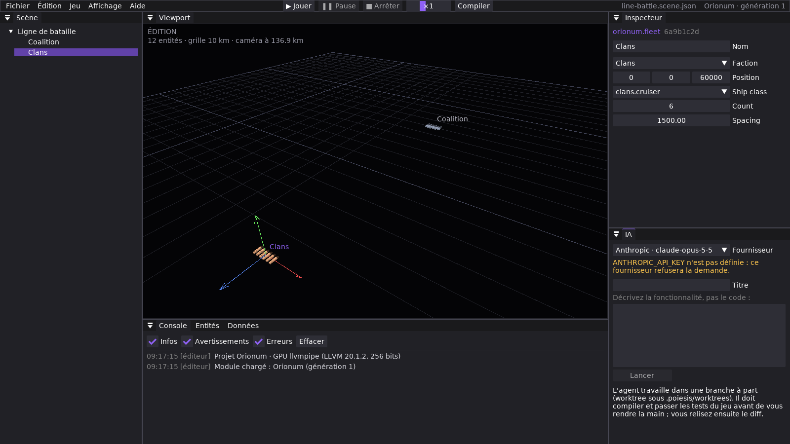
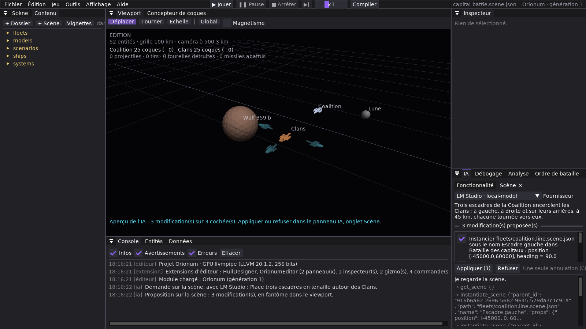
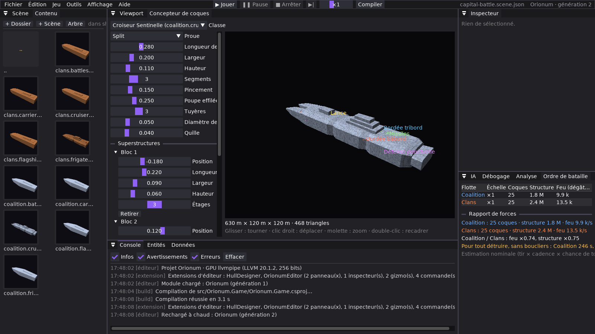
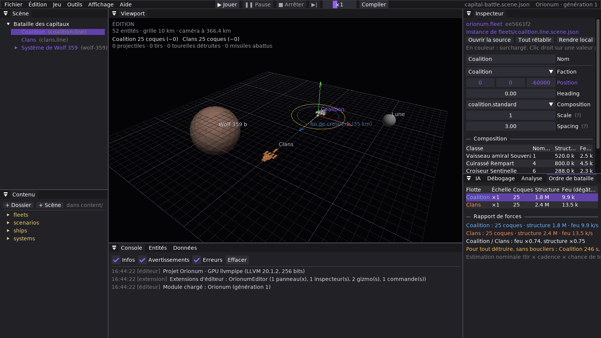
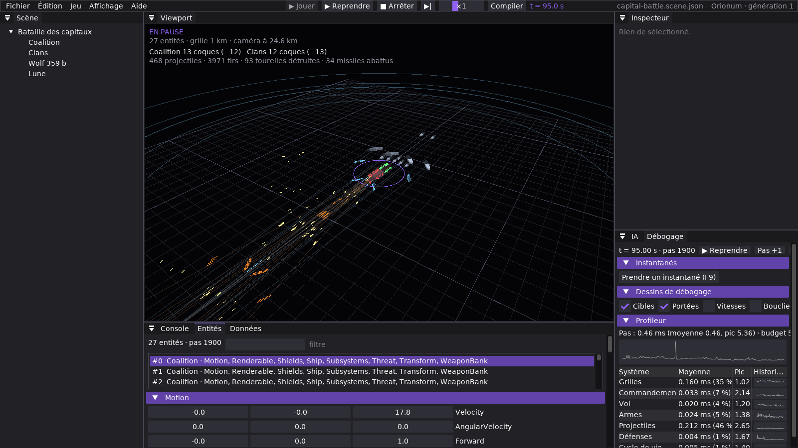
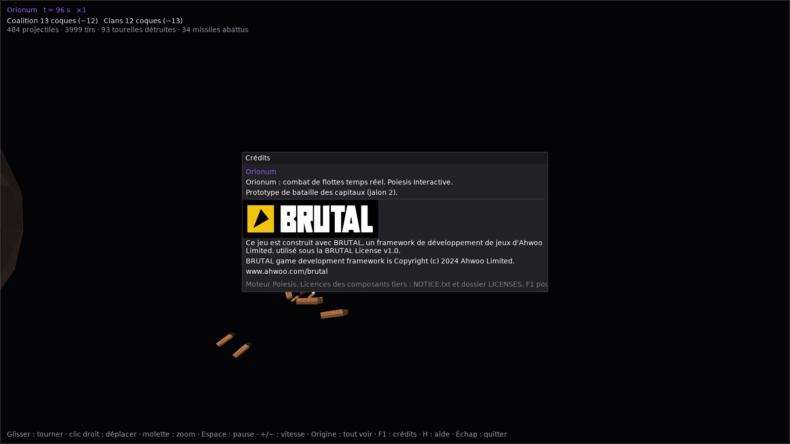

# Poiesis Brutal IDE

Un éditeur de jeux à la manière de Godot ou Unity, construit sur [BRUTAL](https://github.com/ahwootech/BRUTAL), le framework C# d'Ahwoo. On y décrit une fonctionnalité de jeu, et l'IA l'écrit. Outil interne Poiesis ; premier jeu : *Orionum Battles*.

BRUTAL fournit l'interop, la mémoire, les maths, les jobs et les bindings natifs (Vulkan, GLFW, Dear ImGui, Jolt…), sans éditeur, ni scene graph, ni renderer. Ce dépôt ajoute ce qui manque : un moteur (nœuds et ECS, sim à pas fixe, rendu Vulkan) et son éditeur.



- Décisions : [docs/DECISIONS.md](docs/DECISIONS.md)
- Architecture : [docs/ARCHITECTURE.md](docs/ARCHITECTURE.md)
- Jalons : [docs/ROADMAP.md](docs/ROADMAP.md)

## État

Jalon 4a terminé, 68 tests passent. On peut :
- **composer une scène à plusieurs nœuds** : multi-sélection (Ctrl+clic, Maj+glisser pour un rectangle, Ctrl+A), édition groupée dans l'inspecteur, suppression, duplication et copie du groupe ;
- **transformer** avec trois gizmos (déplacer W, tourner E, échelle R), autour du centre du groupe, dans le repère du monde ou du nœud (L), avec magnétisme sur la grille, par 15° et par 10 % (M, Ctrl l'inverse) ;
- **disposer** : aligner sur un axe ou sur le cap du dernier sélectionné, répartir à intervalles égaux (Édition > Disposer) ;
- **enregistrer des caméras** par scène (Ctrl+1 à 9) et y revenir (1 à 9) ;
- **demander à l'IA de modifier la scène** (panneau IA, onglet Scène) : sa proposition s'affiche en fantôme dans le viewport, on coche ce qu'on garde et on applique en une seule commande annulable.



Au jalon 3b, le jalon 3 (modèles, contenu, réutilisation) s'est achevé. On peut :
- **concevoir une coque** dans le concepteur d'Orionum, une extension du jeu : proue, segments, superstructures, tuyères et quille, avec un aperçu 3D. Les tourelles se posent sur la coque, puis on enregistre dans la classe de vaisseau (le jeu est rechargé) ou on exporte en glTF ;
- **importer des modèles glTF** (`.glb`, `.gltf`), optimisés par meshoptimizer, avec leur texture en PNG, JPEG ou KTX2 (Basis Universal). Une classe de vaisseau les désigne par `"model": "models/….glb"` ;
- voir le contenu en **vignettes** rendues hors écran : scènes, modèles, et classes de vaisseaux (le jeu fournit leur vignette) ;
- demander à l'IA un **outil d'éditeur** : elle écrit une extension dans la DLL du jeu, que l'on relit, accepte, et qui se recharge à chaud.



Au jalon 3a :
- **réutiliser des scènes**, à la Godot : une flotte type ou un système stellaire s'instancie dans plusieurs scénarios, chaque instance ne gardant que ses différences (surcharges) ;
- faire d'une branche de la scène une scène réutilisable (clic droit > Enregistrer comme scène) ;
- **copier-coller** des nœuds, d'une scène à l'autre ;
- parcourir `content/` dans le **navigateur de contenu** : ouvrir, créer, renommer, déplacer. Les scènes qui instancient un fichier déplacé sont mises à jour ;
- étendre l'éditeur depuis le jeu, par l'**API d'extension** : Orionum ajoute un panneau « Ordre de bataille », un inspecteur de composition des flottes, un gizmo de rayon des astres et une commande « Aligner les flottes ».



Au jalon 2b :
- export du jeu pour Windows ou Linux, autonome, avec splash et crédits BRUTAL ;
- erreurs de build et tests en échec ouverts dans VS Code ;
- séries de batailles analysées par l'IA.

Le reste ci-dessous date du jalon 2a.

**Orionum** a réécrit sa bataille des capitaux sur le moteur, à partir des données du POC :
- dix classes de vaisseaux, en JSON éditable ;
- vol newtonien et croisière ;
- boucliers à six faces et sous-systèmes ;
- bordées, lances, canons axiaux, missiles et défense ponctuelle ;
- dégâts localisés : les tourelles sautent une à une.

La sim est déterministe, même graine, même bataille, quel que soit le nombre de threads. Le 500 contre 500 tourne à environ 3 ms par pas.

**L'éditeur** :
- sélectionne et déplace les flottes (gizmos de translation et de cap), édite leurs propriétés, annule et rétablit ;
- lance la partie dans l'éditeur, la met en pause, avance pas à pas ;
- édite les composants en direct, prend des instantanés et y revient ;
- affiche les dessins de débogage du jeu par canal et le profileur par système ;
- compile et recharge le jeu à chaud ;
- confie une fonctionnalité à l'IA, dont on relit et accepte le diff.



## Prérequis

- [SDK .NET 10](https://dotnet.microsoft.com/download), et `dotnet` dans le `PATH` (l'éditeur compile le jeu avec).
- Windows x64 et un GPU Vulkan 1.3 avec des pilotes à jour. Les paquets `Ahwoo.Brutal.*` viennent de NuGet.
- Git : le workflow IA crée une branche et un worktree par fonctionnalité.
- Pour l'IA, au choix : `ANTHROPIC_API_KEY`, `OPENAI_API_KEY`, `GEMINI_API_KEY`, ou un serveur local Ollama (port 11434) ou LM Studio (port 1234).

## Lancer l'éditeur

```sh
dotnet build
dotnet run --project src/Poiesis.Editor -- games/Orionum
```

Le dossier passé en argument est un projet de jeu : il contient un `poiesis.project.json`, qui indique le projet C# du gameplay, sa DLL, ses tests et la scène de départ. Au premier lancement, l'éditeur compile le jeu s'il ne trouve pas sa DLL.

| Action | Commande |
| --- | --- |
| Tourner la caméra | glisser (clic gauche) dans le viewport |
| Déplacer la caméra | glisser (clic droit), ou Maj + glisser (clic milieu) |
| Zoomer | molette (de 20 m à 5 000 km) |
| Sélectionner | clic sur un vaisseau, ou dans l'arbre de scène |
| Déplacer la sélection | glisser une flèche du gizmo (X rouge, Y vert, Z bleu) |
| Cadrer la sélection | F ou double-clic |
| Annuler, rétablir | Ctrl+Z, Ctrl+Y |
| Dupliquer, supprimer | Ctrl+D, Suppr (ou clic droit dans l'arbre) |
| Jouer, arrêter | F5, Maj+F5 (ou les boutons de la barre de menus) |
| Pause, un pas de sim | F6, F10 (en pause) |
| Instantané de la partie | F9 ; « Revenir » dans le panneau Débogage |
| Tourner une flotte | glisser l'anneau jaune (son cap) |
| Compiler et recharger le jeu | Ctrl+B |
| Enregistrer la scène | Ctrl+S |
| Capture d'écran | F12, dans `<projet>/.poiesis/captures/` |
| Lancer les tests du jeu | Ctrl+T ; un clic sur un échec l'ouvre dans VS Code |
| Ouvrir une erreur de build | clic sur la ligne dans la console |
| Exporter le jeu | Jeu > Exporter le jeu > Windows x64 ou Linux x64 (dans `<projet>/builds/`) |
| Analyser l'équilibrage | panneau Analyse : jouer une série, puis demander à l'IA |
| Copier, couper, coller des nœuds | Ctrl+C, Ctrl+X, Ctrl+V (entre scènes aussi) |
| Instancier une scène | la glisser du panneau Contenu sur un nœud de l'arbre, ou clic droit > Instancier une scène |
| Faire d'une branche une scène | clic droit sur le nœud > Enregistrer comme scène |
| Rétablir une surcharge | clic droit sur la valeur (en couleur) dans l'inspecteur |
| Déplacer un fichier de contenu | le glisser sur un dossier du panneau Contenu (références mises à jour) |
| Outils du jeu | menu Outils, et les panneaux et gizmos fournis par le jeu |
| Vignettes du contenu | bouton « Vignettes » du panneau Contenu (et bulle au survol d'un fichier) |
| Concevoir une coque | onglet « Concepteur de coques », à côté du viewport : choisir la classe, régler, « Poser les tourelles sur la coque », « Enregistrer et recharger » |
| Demander un outil d'éditeur à l'IA | panneau IA > « Modèle : outil d'éditeur », compléter, Lancer |
| Sélection multiple | Ctrl+clic (arbre ou viewport), Maj+glisser (rectangle), Ctrl+A ; le dernier choisi est le principal |
| Gizmos | W déplacer, E tourner, R échelle ; L repère local ou global ; M magnétisme (Ctrl l'inverse pendant le glissement) |
| Aligner, répartir | Édition > Disposer (sur le dernier sélectionné) |
| Caméras enregistrées | Ctrl+1 à 9 pour enregistrer, 1 à 9 pour revenir (Affichage > Caméras) |
| Modifier la scène avec l'IA | panneau IA, onglet Scène : demander, relire le fantôme, cocher, Appliquer |

L'éditeur de code se règle dans `<projet>/.poiesis/settings.json` (VS Code par défaut) :

```json
{ "codeEditor": { "command": "code", "goto": "--goto {file}:{line}:{column}", "open": "{folder}" } }
```

## Jeu exporté

L'export produit un dossier et une archive zip autonomes : le joueur Poiesis, au nom du jeu, avec son runtime .NET, la DLL du jeu, son contenu, `game.json`, le logo et le `NOTICE.txt` de BRUTAL. Rien d'autre à installer qu'un pilote Vulkan.

| Action | Commande |
| --- | --- |
| Tourner, déplacer, zoomer | glisser, clic droit, molette |
| Pause, vitesse | Espace, + et − |
| Tout voir | Origine |
| Crédits | F1 |
| Quitter | Échap |



La disposition des panneaux est gardée dans `<projet>/.poiesis/imgui.ini` ; « Affichage > Disposition par défaut » la remet à zéro.

## Autres commandes

```sh
dotnet test
```

Jouer une série de parties sans fenêtre et obtenir les victoires et les mesures du jeu :

```sh
dotnet run --project src/Poiesis.Headless -c Release -- games/Orionum/src/Orionum.Game/bin/Release/net10.0/Orionum.Game.dll games/Orionum/content games/Orionum/content/scenarios/capital-battle.scene.json --runs 20 --seed 1
```

Jouer une seule bataille et obtenir son bilan et le temps de chaque système (ici 500 contre 500, 180 s simulées) :

```sh
dotnet build -c Release
dotnet run --project src/Poiesis.Headless -c Release -- games/Orionum/src/Orionum.Game/bin/Release/net10.0/Orionum.Game.dll games/Orionum/content games/Orionum/content/scenarios/great-battle.scene.json 180
```

### Vérifier l'éditeur sans écran

L'éditeur tourne aussi sans GPU, avec le Vulkan logiciel de Mesa (lavapipe), et sans écran, sous Xvfb. C'est ainsi qu'il est vérifié dans le cloud et qu'il pourra l'être en CI. `--capture` enregistre une image puis quitte. `--do` joue un petit script : `select:<nom>`, `frame`, `play`, `pause`, `step:<n>`, `advance:<secondes>`, `snapshot`, `restore`, `entity:<slot ou nom de flotte>`, `channel:<canal>`, `about`, `build`, `wait:<images>`, `focus:<panneau>`, `open:<scène>`, `save`, `copy`, `paste`, `instantiate:<scène>`, `move:<de>><vers>`, `set:<Propriété>=<json>`, `tool:<commande>`, `grid`, `content-select:<chemin>`, `feature:<titre>|<description>`, `wait-review`, `accept`, `select-all`, `mode:<move|rotate|scale>`, `local`, `snap`, `align:<x|y|z>`, `distribute:<x|y|z>`, `camera-save:<n>`, `camera:<n>`, `scene-ask:<demande>`, `wait-scene`, `scene-apply`, `scene-reject`, `capture:<png>`, `exit`, `tests[:filtre]`, `open-first-location`, `export:<windows|linux>`, `series:<n>`, `provider:<nom>`, `ask:<question>`.

```sh
sudo apt-get install -y xvfb mesa-vulkan-drivers libvulkan1
```

```sh
xvfb-run -a -s "-screen 0 1600x900x24" dotnet src/Poiesis.Editor/bin/Debug/net10.0/Poiesis.Editor.dll games/Orionum --splash 0 --frames 60 --capture shot.png --do play --do advance:95 --do pause --do entity:Coalition --do channel:Cibles --do frame
```

## Licence

BRUTAL est distribué sous la [BRUTAL License v1.0](https://github.com/ahwootech/BRUTAL/blob/main/LICENSE.txt). L'éditeur affiche le logo BRUTAL au démarrage, crédite Ahwoo dans « Aide > À propos » et livre le `NOTICE.txt` de BRUTAL à côté de son exécutable. Chaque jeu distribué devra faire de même.
