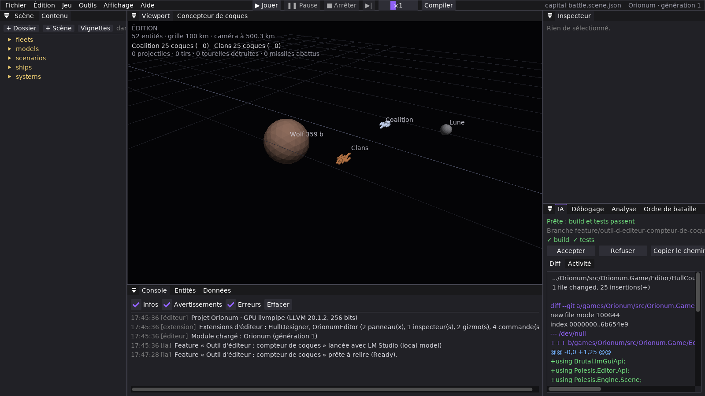
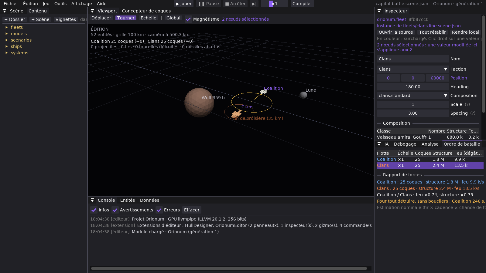
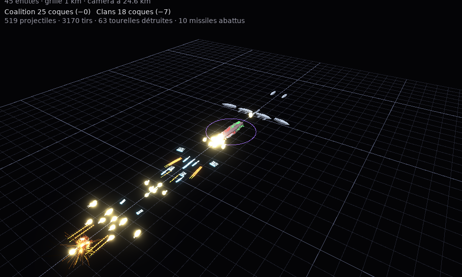
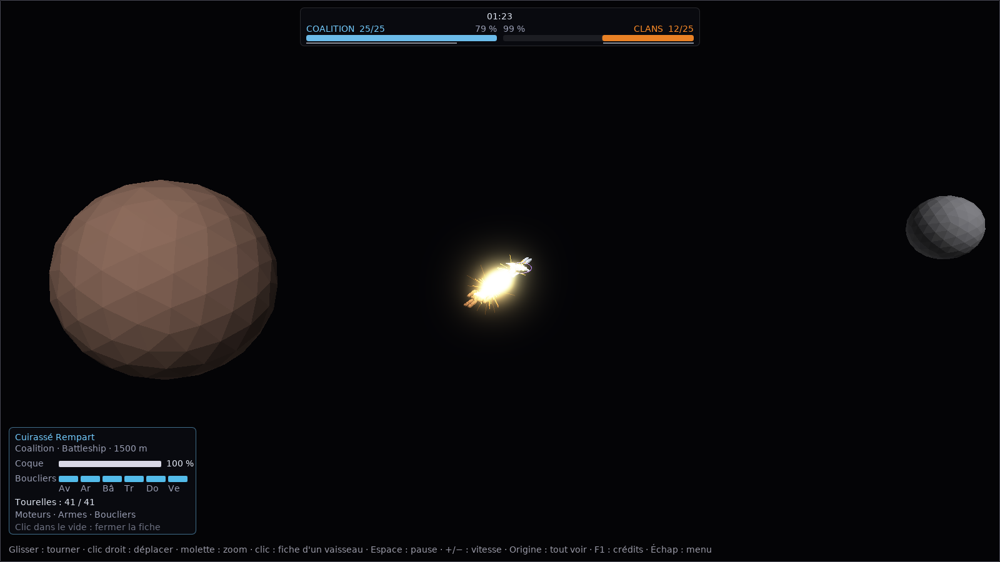
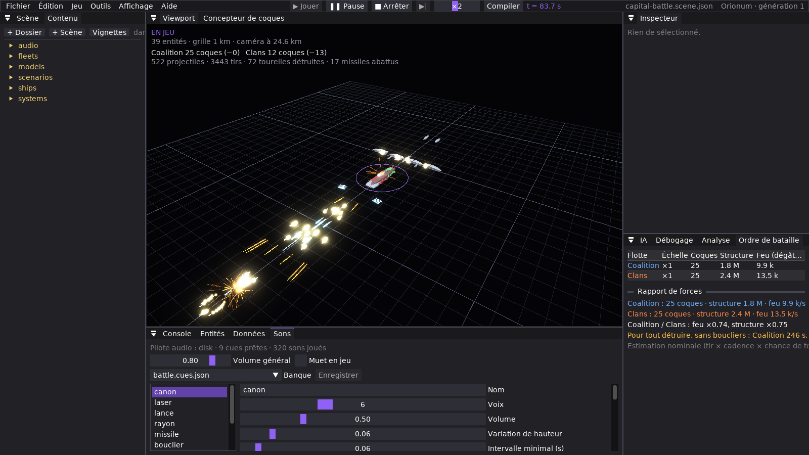
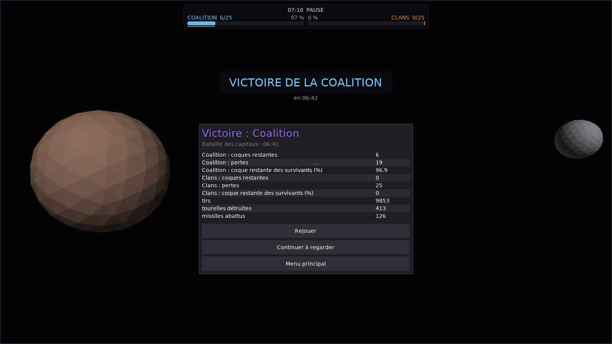

# Jalons

Avec une équipe d'une ou deux personnes, chaque jalon est une **tranche verticale utilisable**, pas une couche complète. Un jalon est fini quand on peut faire la démo décrite dans son critère.

## J0 : squelette ✅

- Solution .NET 10 et paquets BRUTAL, compilée et testée.
- ECS déterministe, nœuds, sérialisation JSON, cuisson, pas fixe.
- Module de jeu rechargé à chaud, déchargement vérifié par test.
- Modèle de l'éditeur : document, sélection, annuler/rétablir, Play/Pause/Stop, hot reload qui garde la scène.
- IA : conversation neutre, Anthropic (SDK officiel), client compatible OpenAI (OpenAI, Gemini, Ollama, LM Studio), boucle d'agent, outils confinés au worktree, workflow feature (branche, garde-fous, diff, accepter ou refuser).
- Orionum minimal : deux flottes JSON, approche et combat placeholder, runner headless.

## J1 : la tranche verticale de l'éditeur ✅

Critère : *on ouvre Orionum dans l'IDE, on déplace une flotte dans le viewport, on change le nombre de croiseurs dans l'inspecteur, on appuie sur Play et on voit la bataille ; on demande à l'IA « les croiseurs des Clans tirent 20 % plus loin », on relit le diff, on accepte, le jeu se recharge à chaud sans fermer l'éditeur.*

Démontré de bout en bout sous Xvfb, avec Vulkan logiciel, souris et clavier simulés par `xdotool` : sélection au clic, gizmo, Ctrl+Z, Ctrl+D, F5, Ctrl+B et rechargement. Pour l'IA, un serveur local compatible OpenAI jouait l'agent ; le reste était réel (worktree, build et tests du jeu dans le worktree, diff, fusion, recompilation, rechargement en génération 2).

| # | Élément | État |
| --- | --- | --- |
| 1 | **Vulkan** : device, swapchain, viewport hors écran (une cible par image en vol), maillages instanciés éclairés, lignes | ✅ |
| 2 | **ImGui** sur GLFW et Vulkan, docking, disposition par défaut sauvegardée par projet | ✅ |
| 3 | **Splash BRUTAL** au démarrage, crédits dans « À propos », `NOTICE.txt` livré | ✅ |
| 4 | **Panneaux** : arbre (ajouter, dupliquer, supprimer, glisser-déposer), inspecteur généré (float, int, bool, enum, `float3`, chaîne, référence de contenu), console, Play/Pause/Stop et vitesse dans la barre de menus | ✅ |
| 5 | **Viewport** : caméra orbitale, sélection au clic, gizmo de translation sur trois axes, aperçu cuit en édition, taille apparente minimale (vue tactique) | ✅ |
| 6 | **Entités en direct** : liste, composants et valeurs | ✅ |
| 7 | **Build intégré** : Ctrl+B, diagnostics dans la console, rechargement à chaud à la fin | ✅ (les erreurs ne sont pas encore cliquables) |
| 8 | **Panneau IA** : fournisseur, description, actions de l'agent, garde-fous, diff coloré, Accepter, Refuser, chemin du worktree, jetons | ✅ (vérifié avec un serveur simulé ; aucun appel réel à un fournisseur depuis le cloud, faute de clé) |
| 9 | **Données** : édition des `*.ship.json`, enregistrement et rechargement du module | ✅ |

Pas encore fait :
- erreurs de build cliquables ;
- « Enregistrer sous » ;
- dialogues de fichiers natifs ;
- fenêtres ImGui détachables (multi-viewports) ;
- édition de l'arbre pendant une partie.

## J1.5 : à vérifier sur Windows

Le jalon 1 a été écrit et testé sous Linux, sans GPU. À confirmer sur un poste Windows avec un vrai GPU :

- démarrage, police Segoe UI, redimensionnement de la fenêtre, glisser-déposer des onglets ;
- fluidité du viewport sur la scène d'exemple, puis avec 500 coques par camp ;
- un vrai tour d'IA avec chacun des fournisseurs (Anthropic, OpenAI, Gemini, Ollama ou LM Studio) ;
- fusion d'une feature quand le dépôt a des modifications locales non commitées (la fusion git refuse alors de toucher les fichiers concernés ; le message doit être clair).

## Principe des jalons suivants

Le jeu tire l'éditeur (décision du 2026-11-24) : chaque jalon d'Orionum livre aussi les outils d'éditeur dont il a besoin, et rien n'est construit « au cas où ». À la fin du J4, l'éditeur couvre les quatre familles jugées indispensables :
- contenu et réutilisation ;
- édition de scène avancée ;
- débogage en jeu ;
- code et build.

## J2a : Orionum réécrit et débogage en jeu ✅

Critère : *la bataille des capitaux tourne dans l'éditeur ; on la met en pause sur un tir, on avance image par image, on modifie la coque d'un vaisseau en direct, on prend un instantané et on y revient ; le profileur montre le coût de chaque système.*

Jeu :
- vol newtonien assisté, croisière, boucliers à 6 faces, sous-systèmes, tourelles et lances, dégâts localisés ;
- index spatial et phases parallèles (`JobScheduler` de BRUTAL), objectif 500 contre 500 fluide ;
- rendu de masse : instanciation, icônes tactiques au loin.

Éditeur :
- pause, image par image, édition des composants en direct ;
- instantanés manuels de la partie ;
- dessin de débogage fourni par le jeu (portées, cibles, tirs) ;
- profileur par système ;
- gizmo de rotation.

### Bilan du J2a

Démontré dans l'éditeur sous Xvfb, et par 31 tests :
- la bataille des capitaux se met en pause en plein combat et avance pas à pas ;
- on sélectionne un vaisseau amiral : portées, cibles et tourelles s'affichent (vivantes ou détruites) ;
- on édite ses composants, on prend un instantané, on avance de 45 s et on revient exactement ;
- le profileur montre le coût de chaque système ;
- la grande bataille 500 contre 500 tourne dans l'éditeur ;
- l'anneau de cap fait tourner une flotte, et l'action est annulable.

| Élément | État |
| --- | --- |
| Données : 10 classes et 2 compositions en JSON (`content/ships`, `content/fleets`), tourelles décrites par rangées et répartitions | ✅ |
| Vol newtonien assisté (ordinateur de vol, rotation bang-bang, vitesse sûre), croisière et sortie de croisière | ✅ |
| Styles d'engagement par classe : axe, bordée, orbite, retrait | ✅ |
| Boucliers à 6 faces, sous-systèmes (moteurs, armes, générateurs) avec réparation, menace par face | ✅ |
| Bordées, tourelles, lances (rayon continu), canon axial (rayon ou obus perçant), missiles guidés, défense ponctuelle | ✅ |
| Dégâts localisés : impact sur la coque allongée, usure puis destruction de la tourelle la plus proche | ✅ |
| Index spatial, phases parallèles déterministes (`JobScheduler`) ; 500 contre 500 : ~3 ms par pas en Release sur 4 cœurs | ✅ |
| Rendu de masse : instanciation, taille apparente minimale ; traînées, rayons, explosions dessinés par le jeu | ✅ |
| Pause, pas à pas (F6, F10), édition des composants en direct, structures imbriquées comprises | ✅ |
| Instantanés manuels (F9, Revenir), avec les ressources de la bataille copiées | ✅ |
| Dessins de débogage du jeu par canal : cibles, portées, vitesses, boucliers, escadres ; HUD de bataille | ✅ |
| Profileur par système : moyenne, pic, historique ; images par seconde | ✅ |
| Gizmo de rotation : anneau de cap sur les nœuds qui ont une propriété `Heading` | ✅ |

Volontairement hors du J2a :
- les escadrilles des porteurs (hangars et chasseurs) ;
- l'IA de commandement (les escadres engagent l'ennemi le plus proche) ;
- les capacités Orionum ;
- la gravité et les collisions des astres (décor seulement) ;
- l'équilibrage : la Coalition l'emporte le plus souvent, à vérifier avec l'analyse IA du J2b.

## J2b : sortir le jeu de l'éditeur ✅

Critère : *un joueur lance Orionum exporté, sans l'éditeur ; une erreur de build s'ouvre dans VS Code à la bonne ligne ; l'IA explique pourquoi les Clans gagnent 70 % des batailles.*

- Erreurs de build cliquables, ouvertes dans VS Code (`code --goto`), ouverture du projet C#, tests du jeu lancés depuis l'éditeur.
- Export Windows autonome : exécutable hôte, DLL du jeu, contenu, splash et `NOTICE.txt` BRUTAL.
- IA qui analyse une partie ou une série en headless : équilibrage, bugs, performances.

### Bilan du J2b

| Élément | État |
| --- | --- |
| **Joueur** (`Poiesis.Player`) : charge `game.json`, splash BRUTAL, scène de départ, caméra, pause, vitesse, HUD du jeu, crédits (F1) | ✅ |
| **Bibliothèque commune** (`Poiesis.Runtime`) : hôte ImGui, thème, splash, `WorldView` (caméra, entités, dessins du jeu, sélection), partagée par l'éditeur et le joueur | ✅ |
| **Export** Windows x64 et Linux x64 depuis l'éditeur (Jeu > Exporter) : publication autonome, DLL du jeu, contenu, manifeste, `NOTICE.txt`, zip | ✅ testé : export Windows produit depuis Linux (43 Mo zippés) ; export Linux lancé hors du dépôt, sans SDK, sous Xvfb |
| **VS Code** : erreurs de build et tests en échec cliquables dans la console (`code --goto`), ouverture du projet, commande réglable par projet | ✅ vérifié avec une erreur et un test en échec réels, et un faux `code` qui note ses appels |
| **Tests du jeu** depuis l'éditeur (Ctrl+T) : totaux, échecs avec message et emplacement ; erreurs de compilation si les tests ne compilent pas | ✅ |
| **Bilan de partie** (`IGameReporter`) et **séries** (`Series`, `Poiesis.Headless --runs`) : victoires, durées, mesures du jeu sur N graines | ✅ |
| **Panneau Analyse** : série en arrière-plan, question à l'IA avec les résultats et les données du jeu, réponse convertible en feature | ✅ vérifié avec un serveur local simulé ; pas d'appel réel faute de clé |

**Premier constat de l'analyse** : sur 20 graines, la Coalition gagne 100 % des batailles des capitaux, en 415 s environ, et finit avec 6 coques à 96 %. L'équilibrage est le premier travail à confier au workflow « analyse puis feature ».

À vérifier sur Windows : lancement du `Orionum.exe` exporté (sans console), Segoe UI, pilote Vulkan réel.

## J3 : modèles, contenu et réutilisation

Critère : *on conçoit un croiseur dans un concepteur de coques propre à Orionum, on en fait une flotte type réutilisable, on l'instancie dans deux scénarios avec des surcharges, et on la retrouve dans le navigateur de contenu.*

Découpé en deux, comme le J2 :

## J3a : l'ossature de la réutilisation ✅

Critère : *la ligne de la Coalition est une scène, instanciée dans les deux scénarios avec des surcharges ; on la retrouve et on la déplace dans le navigateur de contenu sans rien casser ; on copie une flotte d'un scénario à l'autre ; Orionum ajoute ses propres outils à l'éditeur, rechargés à chaud.*

| Élément | État |
| --- | --- |
| **Scènes imbriquées** : `{"instance": "…", "overrides": {…}}`, seules les différences avec la source sont enregistrées ; identifiants dérivés (deux instances ne partagent rien) ; instances dans des instances ; boucles refusées | ✅ |
| Éditeur : instances en couleur dans l'arbre, structure verrouillée, surcharges en couleur dans l'inspecteur, rétablir une valeur ou tout, ouvrir la source, rendre local, **enregistrer une branche comme scène** | ✅ |
| Orionum : `fleets/coalition.line`, `fleets/clans.line` et `systems/wolf-359` instanciés par les deux scénarios (même bataille qu'avant : bilan identique après 300 s simulées) | ✅ |
| **Copier-coller** (Ctrl+C, X, V) par le presse-papiers du système, entre scènes, nouveaux identifiants, une seule annulation | ✅ |
| **Navigateur de contenu** : arborescence, ouvrir (scène, ou données dans le panneau Données), créer dossier et scène, dupliquer, renommer, déplacer par glisser-déposer, supprimer avec la liste des scènes touchées ; références réécrites (scènes et scène de départ du projet) | ✅ |
| **API d'extension** (`Poiesis.Editor.Api`) : panneaux, sections d'inspecteur, gizmos avec poignées, commandes du menu Outils ; modifications annulables, glissement d'une poignée = une seule commande ; extension en erreur désactivée jusqu'au rechargement | ✅ |
| Première extension d'Orionum : Ordre de bataille, composition des flottes, rayon des astres, fin de croisière, aligner les flottes | ✅ vérifiée au rechargement à chaud (génération 2, ancienne DLL déchargée) |

**Ce que l'ordre de bataille montre déjà** : sur le papier, les Clans ont plus de structure (×1,33) et plus de feu (×1,36) que la Coalition, qui gagne pourtant 100 % des batailles (J2b). L'écart vient donc d'ailleurs : boucliers, portées, manœuvre. C'est une piste pour l'équilibrage.

Reporté au J3b : vignettes rendues hors écran dans le navigateur, filtres.

## J3b : le contenu ✅

Critère du J3 atteint : *le croiseur de la Coalition est conçu dans le concepteur de coques d'Orionum ; sa ligne de bataille est une flotte type, instanciée dans les deux scénarios avec des surcharges ; on retrouve tout dans le navigateur de contenu, en vignettes.*

| Élément | État |
| --- | --- |
| **Maillages du jeu** : `MeshData` et `MeshLibrary` dans le moteur, `Renderable.Asset` ; le rendu téléverse à la première utilisation et libère ce qui ne sert plus ; coordonnées de texture et texture de couleur par maillage | ✅ |
| **Import glTF** (`Poiesis.Engine.Assets`) : scène fusionnée, normales, UV, indices ; meshoptimizer (cache et lecture des sommets) ; texture PNG, JPEG ou KTX2 Basis (transcodée en RGBA) ; **export** `.glb` avec texture KTX2 Basis | ✅ aller-retour testé ; la frégate des Clans est un modèle importé |
| **Concepteur de coques** (extension d'Orionum, au centre) : proues effilée, en lame, massive ou fourchue ; segments et pincement ; superstructures en étages ; tuyères ; quille ; texture de blindage ; aperçu 3D avec les tourelles ; pose des tourelles sur la coque ; enregistrer et recharger ; exporter en glTF | ✅ le croiseur de la Coalition |
| **Aperçu 3D pour les extensions** (`View3D`) et **vignettes** du navigateur de contenu (scènes, modèles, et fichiers que le jeu sait montrer), rendues hors écran et gardées sur disque | ✅ |
| **IA qui écrit des outils d'éditeur** : l'API d'extension (résumé tenu à jour par un test) et les extensions existantes dans le contexte de l'agent, modèle de demande dans le panneau IA | ✅ vérifié de bout en bout avec un agent simulé : extension écrite, garde-fous passés, acceptée, rechargée |
| API d'extension complétée : placement des panneaux, vignettes, aperçu 3D, réglages persistants, demande de rechargement | ✅ |

**Ce que le parcours de l'IA a montré** : au premier essai, les garde-fous ont refusé l'outil écrit par l'agent, parce qu'un test exigeait la liste exacte des extensions d'Orionum. Le test a été assoupli ; le second essai est passé du premier coup.

**Effet sur la bataille** : poser les tourelles du croiseur sur sa nouvelle coque déplace ses bordées de 70 m à 53,5 m de l'axe. Sur 20 graines, rien ne change : la Coalition gagne toujours 100 % des batailles, en 414 s (415 avant), avec 6 survivants à 96 %. Le déséquilibre reste à traiter.

À vérifier sur Windows : rendu des textures, libktx et meshoptimizer natifs dans le jeu exporté.

## J4 : effets, son, UI de jeu, et édition de scène avancée ✅

Critère : *on compose la bataille à l'échelle de Wolf 359 (astres, flottes, escadres) en multi-sélection et magnétisme, ou en demandant à l'IA « place trois escadres en tenaille autour des Clans ». On voit l'aperçu, on valide, et la bataille a ses effets, son son et son HUD.*

Découpé en deux : l'éditeur d'abord (aucune décision en attente), le jeu ensuite (l'audio a été fait avec SDL_mixer).

## J4a : édition de scène avancée et IA sur la scène ✅

| Élément | État |
| --- | --- |
| **Multi-sélection** : Ctrl+clic dans l'arbre et le viewport, rectangle (Maj+glisser), Ctrl+A ; surbrillance ; inspecteur groupé (une valeur pour tous les nœuds d'un même type) ; supprimer, dupliquer, copier, couper le groupe | ✅ |
| **Gizmos** déplacer (W), tourner (E), échelle (R) autour du centre du groupe ; repère local (cap du nœud principal) ou global (L) ; magnétisme sur le pas de la grille, par 15°, par 10 % (M, Ctrl l'inverse) ; barre d'outils du viewport | ✅ vérifié à la souris : groupe tourné de 90°, une seule annulation |
| **Échelle** par convention `[ScaleHandle]` (rayon d'un astre, espacement d'une flotte) ; un groupe s'écarte aussi de son centre | ✅ |
| **Disposer** : aligner sur X, Y, Z ou sur le cap du dernier sélectionné, répartir à intervalles égaux | ✅ |
| **Caméras enregistrées** par scène (Ctrl+1 à 9, 1 à 9, menu Affichage), dans `.poiesis/cameras.json` | ✅ |
| **IA qui agit sur la scène ouverte** : l'agent lit la scène et les types de nœuds, propose ajouts, instances, propriétés, renommages et suppressions sur une copie ; fantômes cyan (ajouts, nouvelles places), rouges (suppressions) et traits de déplacement ; propositions à cocher ; une seule commande annulable | ✅ vérifié avec un agent simulé : trois escadres en tenaille autour des Clans |

Corrigé en chemin : rappeler une caméra faisait planter l'éditeur (le format de lecture des données demande un constructeur sans paramètre) ; l'agent de scène n'était relevé que si son onglet était visible.

## J4b : effets, son, HUD et menus ✅

| Élément | État |
| --- | --- |
| **HDR et bloom** (Vulkan) : la scène est rendue en RGBA16F ; bloom sur 5 niveaux (seuil doux, descente, remontée additive) ; composition avec une courbe douce au-dessus de 0,8, identité en dessous | ✅ |
| **Halos** (`DrawContext.Glow`) : sprites additifs face caméra, instanciés | ✅ |
| **Effets d'Orionum** : traçantes des tirs, rayons et lances, impacts de bouclier en hexagones sur la sphère du bouclier, étincelles sur la coque, explosions (boule de feu, cœur, éclair, gerbe) ; atténués de loin pour ne pas saturer | ✅ |
| **Audio SDL_mixer** (`Poiesis.Audio`, SDL3 et SDL3_mixer de BRUTAL) : la sim émet des événements sonores dans un anneau, l'éditeur et le joueur les jouent ; atténuation selon la distance, panoramique, voix limitées par cue, intervalle minimum, variation de hauteur | ✅ vérifié avec les pilotes `disk` et `dummy` de SDL |
| **Banques de cues éditables** (`content/audio/*.cues.json`) : sons synthétisés (forme d'onde, glissement de fréquence, enveloppe, bruit, filtre, saturation) ou fichiers ; panneau « Sons » : réglages, forme d'onde, écouter, enregistrer ; rechargement à chaud | ✅ 9 cues pour la bataille |
| **HUD du jeu** (`IGameHud`) : horloge, jauges des deux camps, fiche du vaisseau choisi (coque, six faces de bouclier, tourelles, sous-systèmes), bannière de victoire ; aussi dans l'éditeur pendant le Play | ✅ |
| **Menus du joueur** : menu principal (scénarios, scène en fond), pause, options (volumes, bloom, aide, gardées dans `user/options.json`), écran de fin avec le bilan | ✅ export Linux vérifié, SDL3 et SDL3_mixer livrés |

**Bataille** : une bataille des capitaux joue plus de 320 sons en 100 s, chaque cue de la banque au moins une fois. Le 500 contre 500 reste à 2,6 ms par pas : la sim ne fait qu'ajouter des événements dans des listes, en code série, donc reste déterministe.

À vérifier sur Windows et sur une vraie carte son : rien n'a été écouté ici (pas de périphérique audio dans le cloud) ; le signal a été vérifié en écrivant la sortie sur disque. Le déséquilibre d'Orionum (Coalition à 100 %) reste à traiter.

## Plus tard

- Migration de l'état ECS au hot reload (sans arrêter la partie).
- Frise temporelle complète (instantanés réguliers et ordres rejoués), dans le prolongement des instantanés manuels du J2.
- Play en process séparé (Brutal.Monitor) pour tester le build réel.
- Linux, puis peut-être macOS.
